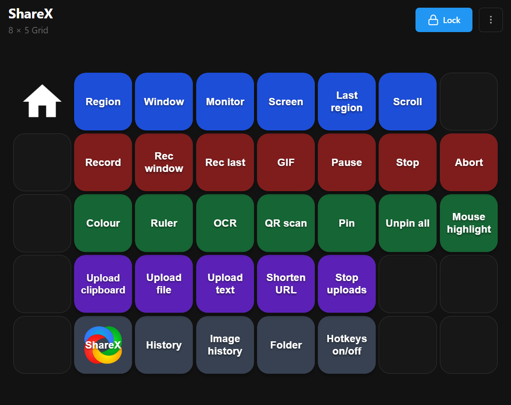
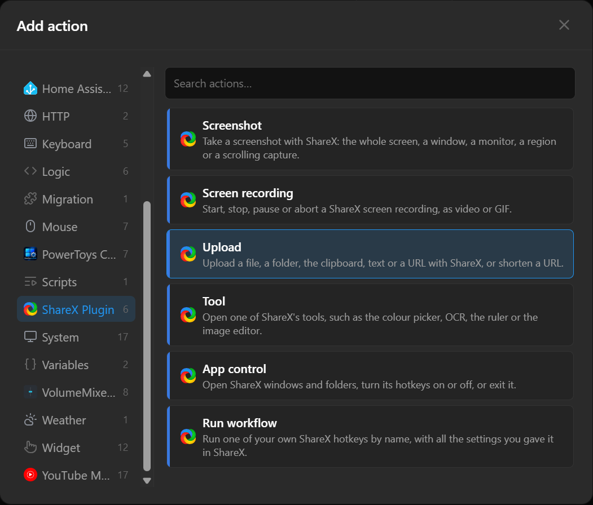
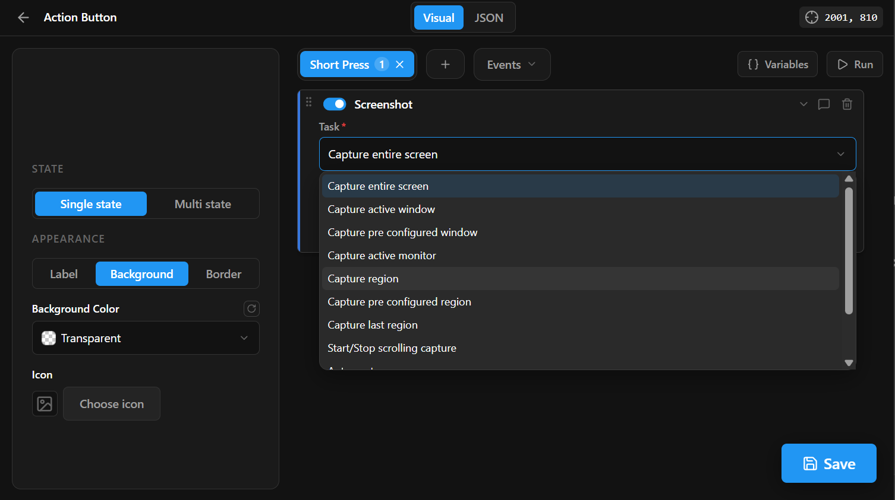

# ShareX Plugin for Macro Deck 3

Run [ShareX](https://getsharex.com/) captures, screen recordings, uploads, tools and your own ShareX
hotkeys from Macro Deck 3 buttons.

This is a port of [jbcarreon123's ShareX plugin](https://github.com/jbcarreon123/MacroDeck2-ShareXPlugin)
for Macro Deck 2, rewritten for the Macro Deck 3 out-of-process plugin SDK. Windows only, and ShareX
must be installed.

## Install

Download the `.macroDeckPlugin` file from the [latest release](https://github.com/Justblair/macrodeck-sharex/releases/latest),
then install it from file in Macro Deck 3. Macro Deck warns that the plugin is not signed by the Store;
that is expected for a plugin installed outside the Store.

## Actions

Each action matches one of the groups in ShareX's own hotkey settings, and you pick the task on the
button. Task names are ShareX's own.

| Action | Tasks |
| --- | --- |
| Screenshot | Entire screen, active window or monitor, region, last region, pre-configured window or region, scrolling and auto capture |
| Screen recording | Start/stop video or GIF recording (full, active window, pre-configured or last region), stop, pause, abort |
| Upload | File, folder, clipboard, text, URL, drag and drop, shorten URL, stop all uploads |
| Tool | All 42 ShareX tools: colour pickers, ruler, OCR, QR codes, pin to screen, image editor, beautifier, effects, converters, video trimmer and the rest |
| App control | Open the main window, history, image history or screenshots folder; toggle hotkeys, actions toolbar or tray menu; exit ShareX |
| Run workflow | Any hotkey you have set up in ShareX, by its name, with all its own settings |

Tasks that open a file (the image editor, OCR, pin to screen, upload file and others) take an optional
file. Leave it blank to choose the file in ShareX.

**Run workflow** is the most flexible: build the exact capture you want as a hotkey in ShareX (its
destinations, after-capture steps and so on), give it a description, and type that description on the
button. It must match exactly, capitals included. A hotkey with no description goes by its task name.

## Finding ShareX

The plugin looks for ShareX by itself: the copy that is running, then the installer's registry entry,
then Program Files, Steam and the Microsoft Store. ShareX does not have to be running; a button starts
it. For a portable copy, set **ShareX location** on the button to `ShareX.exe` or its folder.

## Changes from the Macro Deck 2 plugin

- Six actions with a task list instead of 61 separate actions, covering 81 tasks, 24 of them new.
- New **Run workflow** action for your own ShareX hotkeys.
- Optional file for tasks that open one.
- ShareX is found automatically; there is no settings window.
- Failures (ShareX not found, a missing file, a task ShareX no longer has) show on the button and in
  the log instead of failing silently.
- Dropped: DNS changer and Tweet message, which ShareX itself has removed. The old light and transparent
  region captures are now plain region capture.

### Bringing over Macro Deck 2 buttons

When Macro Deck 3 imports a Macro Deck 2 profile, buttons from the old ShareX plugin are mapped onto
these actions with the same task. Buttons for the two removed tasks are kept but report an error until
you choose another task.

## Building

See [DEVELOPMENT.md](DEVELOPMENT.md) for building, debugging against Macro Deck and packaging.

## Licence

MIT. See [LICENSE](LICENSE). Original work copyright JB Carreon. ShareX is a separate project by its own
authors and is not included.

The plugin icon is the ShareX logo, copyright the ShareX Team, used with the permission of the ShareX
project ([ShareX/ShareX#8921](https://github.com/ShareX/ShareX/issues/8921#issuecomment-6443678880)).
It is taken unmodified from the official [ShareX brand assets](https://getsharex.com/brand-assets) and is
not covered by this repository's MIT licence. This plugin is a community project and is not made or
endorsed by the ShareX Team.
